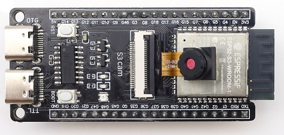

# LEGO-Roboter auf ESP32-S3

Steuerplattform für ein LEGO-Projekt: **2 Servos** (SG90 180° + 360°), **Schrittmotor 28BYJ-48**, **TT-Motor**, **Endschalter**, **HC-SR04**, **IR-Lichtschranke** und eine **einfache Kamera** — bedient per Browser vom PC und vom Android-Handy, programmierbar mit **Blockly**.

> Kurzfassung: Ein **ESP32-S3-WROOM-1 N16R8 CAM** Board (57 × 28 mm, 5 V, WiFi + BLE 5, Kamera on-board) übernimmt alles. Steuerplattform **29,88 €**, komplettes Set **46,70 €** (Preise Stand 11.11.2026, ohne Versand).



## Anforderungen → Lösung

| Anforderung | Lösung |
|---|---|
| Motoren: 2× SG90 (180° + Continuous), 28BYJ-48 + ULN2003, TT-Motor 3–6 V | PCA9685 (Servos, 16 Kanäle) + ULN2003 (Stepper) + DRV8833 (TT-Motor) |
| Sensoren: Endschalter, HC-SR04, IR-Lichtschranke, einfache Kamera | PCF8574 (Schalter/IR) + HC-SR04 direkt + OV2640 on-board (VGA) |
| Nicht bulky, max. 8 × 10 × 3 cm | Board 5,7 × 2,8 cm, alles gestapelt < 7 × 9 × 2,5 cm |
| 5-V-Powerbank | 5 V / ~120 mA Board, Motoren direkt an 5 V (≥ 2,4 A Powerbank) |
| Bluetooth **und** WLAN | WiFi 2.4 GHz + BLE 5 (Web Bluetooth im Browser) |
| Steuerung per Browser (PC + Android) | Web-UI kommt direkt vom Board (`http://legobot.local`) |
| Blockly | Blockly im selben Web-UI + BIPES/Mixly als Alternative |
| Kamerabild im Browser | MJPEG-Stream vom Board (VGA-Standbild/Stream, 10–20 fps) |
| Günstig, < 30 € | Steuerplattform **29,88 €** |

## Kosten

| Paket | Preis |
|---|---|
| **Steuerplattform** (Board, Treiber, Expander, Servo-Treiber, Kleinteile) | **29,88 €** |
| **+ Aktoren & Sensoren** (Falkos Liste komplett) | **46,70 €** |
| Sparvariante (Board aus China, günstiger 360°-Servo, TT-Motor) | **~34,50 €** |

Details mit Links und Bildern: **[docs/02-einkaufsliste.md](docs/02-einkaufsliste.md)**

## Dokumentation

| Datei | Inhalt |
|---|---|
| [docs/01-hardware.md](docs/01-hardware.md) | Board-Steckbrief, warum ESP32-S3, verworfene Alternativen, Grenzen |
| [docs/02-einkaufsliste.md](docs/02-einkaufsliste.md) | Stückliste mit Bildern, Preisen, Shop-Links, Bestellhinweise |
| [docs/03-verkabelung.md](docs/03-verkabelung.md) | Pinplan, Stromversorgung, Pegelwandler, Kapazität, Fallstricke |
| [docs/04-software-blockly.md](docs/04-software-blockly.md) | Die drei Software-Wege, Blockly-Architektur, Protokoll, Flashen |
| [docs/05-mechanik-3d-druck.md](docs/05-mechanik-3d-druck.md) | LEGO-Kupplungen, 3D-Druck-Teile, Toleranzen, Montage |
| [docs/06-erweiterungen.md](docs/06-erweiterungen.md) | Günstige Zusatzsensoren und -aktoren mit Preis |
| [docs/07-3d-adapter.md](docs/07-3d-adapter.md) | Eigene 3D-Adapter (STL + OpenSCAD), Rendering-Bilder, geprüfte Fremdmodelle |

## Projektstatus

- [x] Hardware ausgewählt und bepreist
- [x] Pinplan und Stromkonzept
- [x] Teile bestellen ([Einkaufsliste](docs/02-einkaufsliste.md))
- [ ] Board flashen (PlatformIO, Arduino-Framework)
- [ ] Firmware v0.1: Web-UI + Kamera-Stream + Motor-/Sensor-API
- [ ] Blockly-Blöcke im Web-UI
- [x] 3D-Adapter konstruiert (`hardware/3d/`, STL + parametrisches OpenSCAD)
- [ ] Adapter drucken und Passung testen (Bohrungen ggf. nachziehen)

## Struktur

```
.
├── README.md
├── docs/
│   ├── 01-hardware.md
│   ├── 02-einkaufsliste.md
│   ├── 03-verkabelung.md
│   ├── 04-software-blockly.md
│   ├── 05-mechanik-3d-druck.md
│   ├── 06-erweiterungen.md
│   └── 07-3d-adapter.md
├── hardware/3d/     Eigene Adapter: STL + parametrisches OpenSCAD
├── tools/           Generatoren (Adapter, Verdrahtungsbilder) + SVG-Rasterizer
├── img/wiring/      Pin-für-Pin-Verdrahtungsbilder (SVG)
└── img/             Produktfotos und Renderings (Quelle in der Einkaufsliste verlinkt)
```

## Hinweise

- Preise sind Momentaufnahmen (11.11.2026) und schwanken, besonders bei Amazon-Marketplace und AliExpress.
- Produktfotos in `img/` stammen von den verlinkten Shop-Seiten und dienen nur der Zuordnung der Bauteile.
- Lizenz: [MIT](LICENSE)
