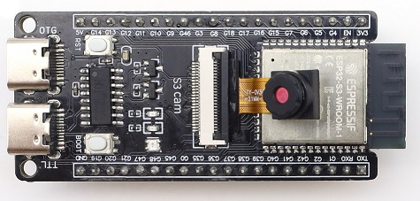
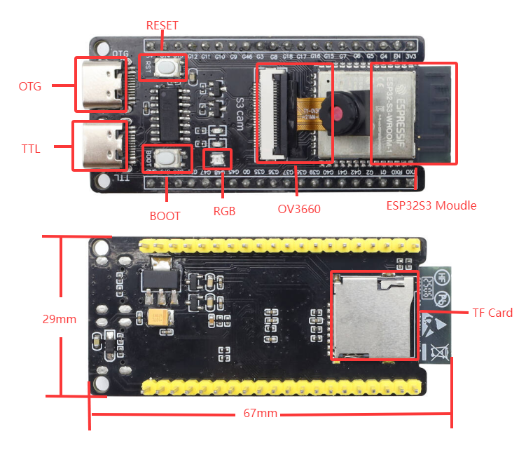

# 01 — Hardware

## Die Wahl: ESP32-S3-WROOM-1 N16R8 CAM (mit OV2640)

| Merkmal | Wert |
|---|---|
| MCU | ESP32-S3, Dual-Core Xtensa LX7 @ 240 MHz |
| Speicher | 16 MB Flash, 8 MB PSRAM (nötig für Kamerapuffer) |
| Funk | WiFi 802.11 b/g/n 2.4 GHz (bis 150 Mbit/s), Bluetooth **LE 5** + Mesh |
| Kamera | OV2640 (2 MP, VGA/QVGA-JPEG-Stream); Varianten mit OV3660/OV5640 ~1–2 € teurer |
| Spannung | 3,3–5 V Eingang, im Betrieb ~120 mA (Stream ~200–250 mA) |
| Maße | 57 × 28 mm (N16R8-Variante) bzw. 67 × 29 mm (keyestudio-Variante) |
| Anschluss | 2× USB-C (1× UART/CH340, 1× USB-OTG) + microSD |
| GPIO | ~11 frei nutzbar (Kamera belegt 14, SD 3, USB 2) |

**Warum dieses Board:** Es ist das einzige Brett unter 30 €, das WiFi **und** BLE, Kamera, PSRAM, USB und genug GPIO gleichzeitig mitbringt — bei 5-V-Versorgung und Streichholzschachtel-Größe. Dual-Core heißt: ein Kern macht Kamerastream/Webserver, der andere Motorregelung und Sensorabfrage. Der PSRAM (8 MB) ist der Punkt, an dem billigere Boards scheitern — ohne ihn kein stabiler MJPEG-Stream.

### Pinout (keyestudio MB0184, gleiche Bauform)

## Variante ohne Kamera

Wenn die Kamera nicht gebraucht wird, ist ein **ESP32-S3-DevKitC-1 (WROOM-1 N8R2, ~10–13 €)** die bessere Wahl: alle 36 GPIOs auf Stiftleisten, dadurch fallen die Expander (PCA9685, PCF8574) weg und Servos wie Sensoren hängen direkt am Board. Pinplan und Bilder: [docs/03-verkabelung.md](03-verkabelung.md#4-variante-ohne-kamera-esp32-s3-devkitc-1).

## Verworfene Alternativen

| Kandidat | Preis | Warum nicht |
|---|---|---|
| **ESP32-CAM (AI-Thinker)** | ~8 € | Nur 1 freier UART, **kein USB** (FTDI-Adapter nötig), ~6 nutzbare Pins, kein PSRAM → zu wenig für 4× Stepper + 2 Servos + 2 Motoren + 4 Sensoren |
| **Raspberry Pi Zero 2 W** | 19,40 € + Kamera ~7 € + SD ~5 € = ~31 € | Technisch stärker (echtes Video, Python/OpenCV, jedes Blockly im Browser), aber: 65 × 30 mm, 2 A Strom, ~20 s Bootzeit, über Budget. Richtige Wahl, wenn später Bildverarbeitung dazukommt |
| **micro:bit v2** | ~22 € | Blockly top, aber kein WiFi und keine Kamera |
| **Arduino Uno / Nano (Clone)** | 3–8 € | 2 KB RAM, kein WiFi, keine Kamera |
| **Raspberry Pi Pico W** | ~6 € | WiFi/BLE ja, Kamera nur über Umwege (kein Kamera-Interface) |
| **Seeed XIAO ESP32S3 Sense** | ~18 € | Winzig und mit Kamera, aber nur ~11 Pins in 2,54-mm-Raster und kein Platz für Steckerleisten |

## Grenzen (bewusst akzeptiert)

- **Kamera:** VGA-Standbild/Stream mit 10–20 fps, JPEG. Gut für "wo fährt der Roboter hin", nicht für schnelle Bewegung oder Bildanalyse on-device.
- **Bluetooth:** nur BLE, kein Bluetooth Classic. Web Bluetooth funktioniert in Chrome/Edge (PC) und Chrome (Android), **nicht** in Safari/iOS.
- **WiFi + BLE gleichzeitig:** technisch möglich (gemeinsame Antenne), aber Durchsatz sinkt. Streaming immer über WiFi, BLE nur als Fallback/Konfiguration.
- **Strom:** Motoren und Servos hängen an derselben 5-V-Powerbank wie das Board. Spitzen bis ~2,5 A → Powerbank mit ≥ 2,4 A Ausgang, Elko an die Motorschiene.
