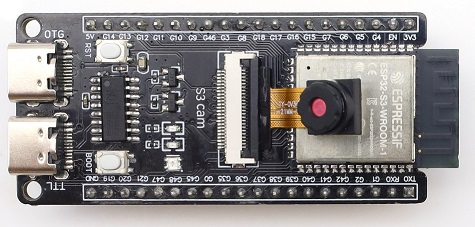
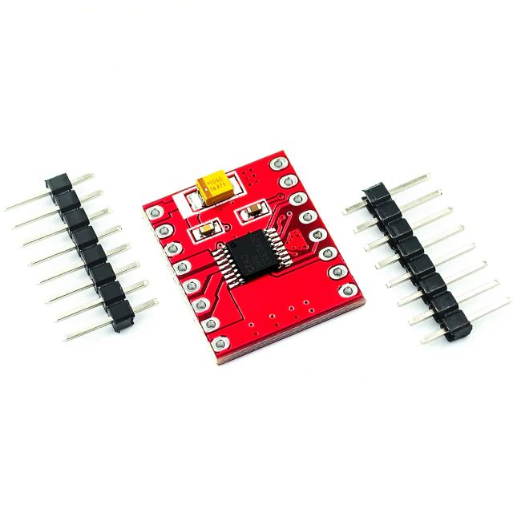
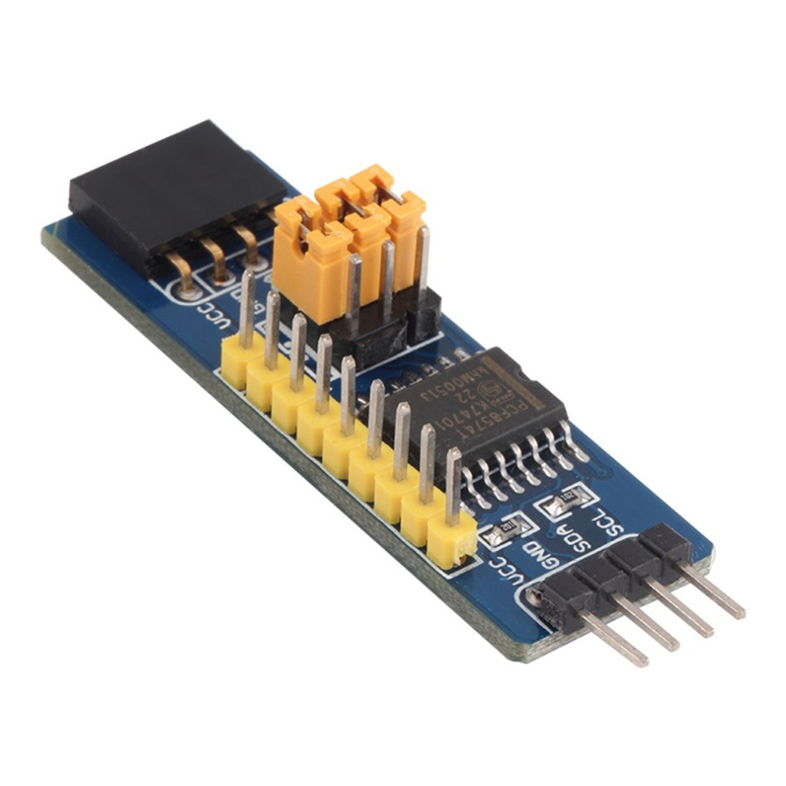
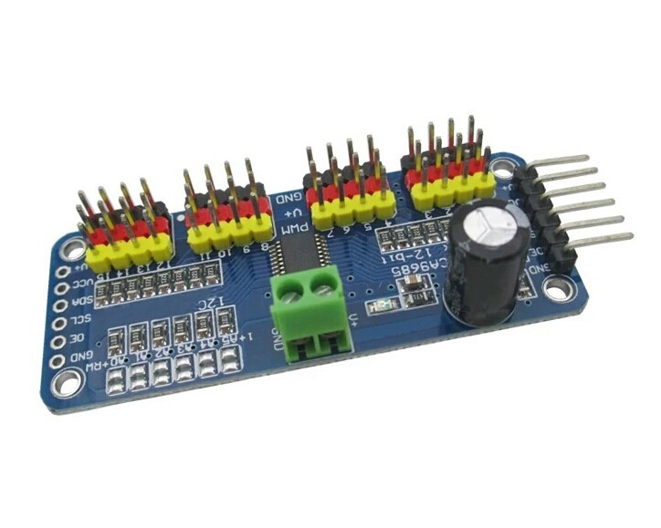
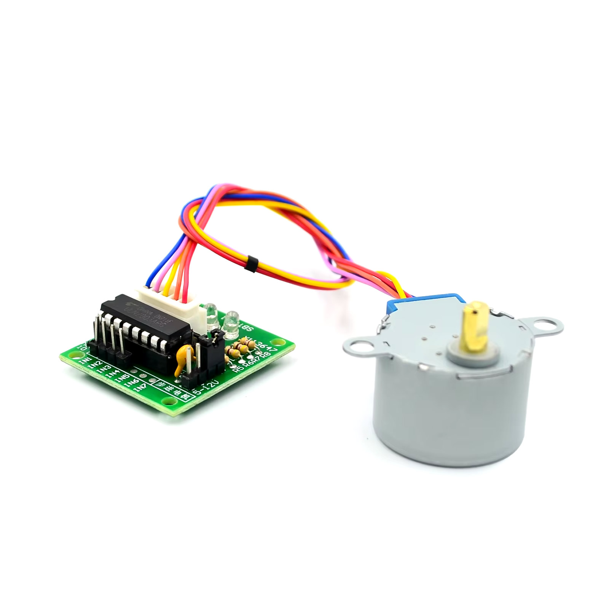
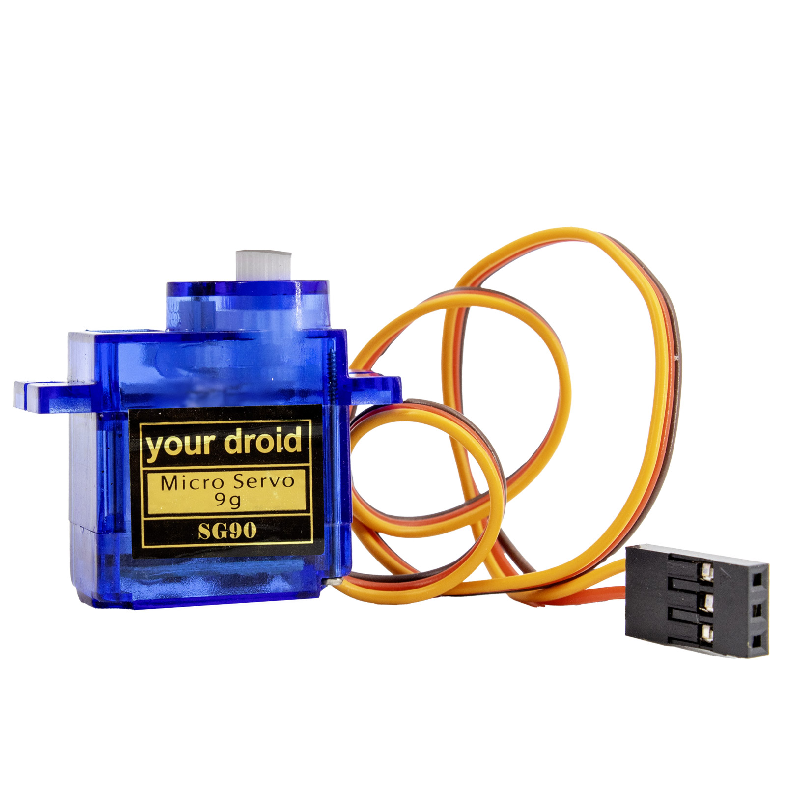
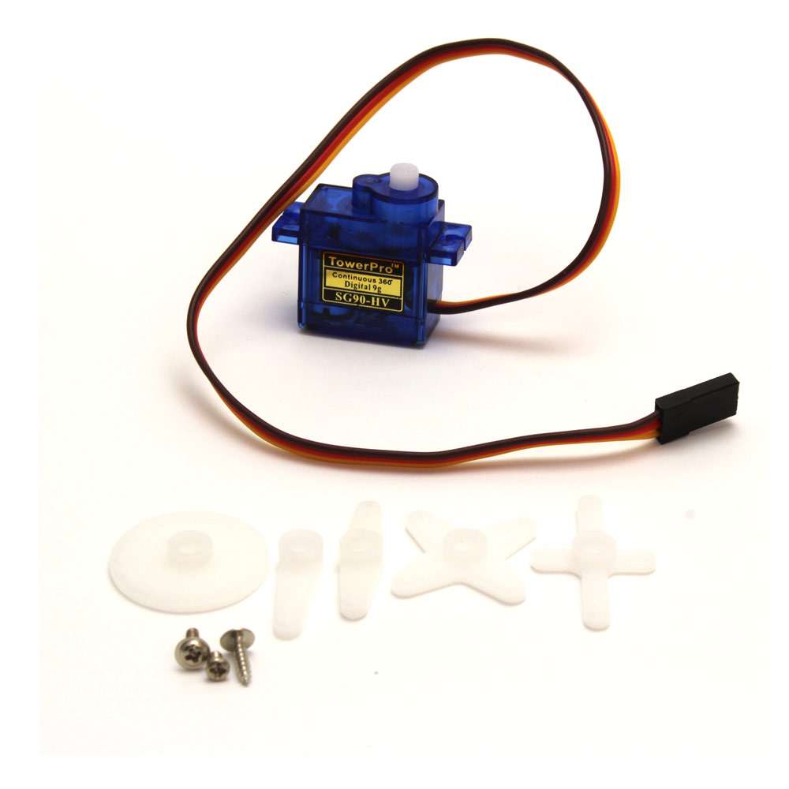
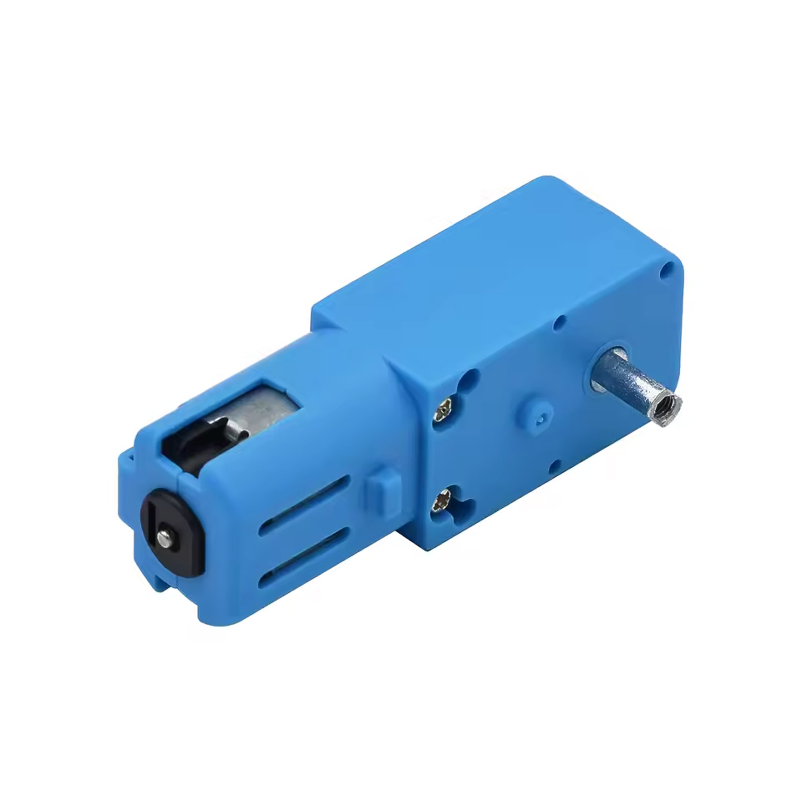
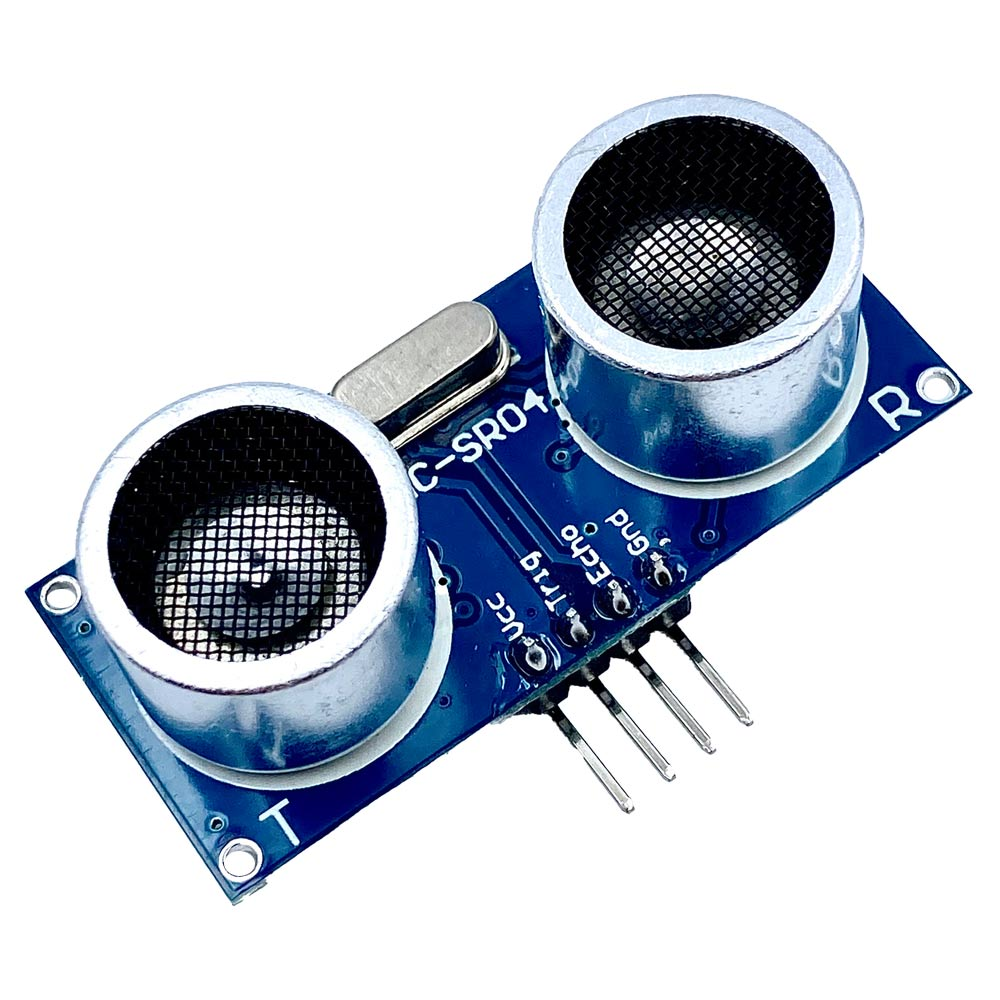
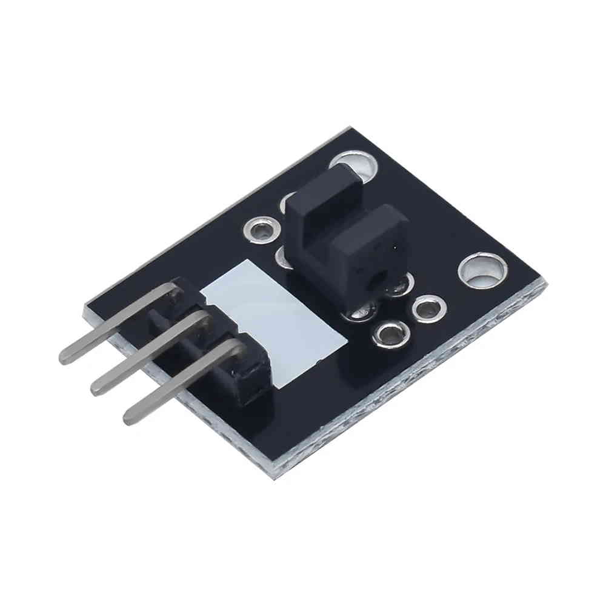

# 02 — Einkaufsliste

Preise geprüft am **11.11.2026**, jeweils ohne Versandkosten. Produktbilder stammen von den verlinkten Shop-Seiten.

## A) Steuerplattform — 29,88 €

| Bild | Bauteil | Warum | Preis | Shop |
|---|---|---|---|---|
|  | **ESP32-S3-WROOM-1 N16R8 CAM**, OV2640, 16 MB/8 MB | Gehirn: WiFi + BLE 5, Kamera, 240 MHz, PSRAM für Stream | **16,70 €** | [Amazon.de](https://www.amazon.de/-/en/Ptdfjspt-ESP32-S3-Development-Bluetooth-ESP32-S3-WROOM-1-black/dp/B0F2QP1VTQ) |
|  | **DRV8833 Motortreiber** (2 Kanäle, 1,5 A) | TT-Motoren; kleiner und kühler als L298N, 3,3-V-Logik ok | **1,59 €** | [roboter-bausatz.de](https://www.roboter-bausatz.de/p/drv8833-dc-motor-treiber-modul-tb6612-alternative) |
|  | **PCF8574 I2C-Expander** (8 Eingänge) | Endschalter + IR-Lichtschranke, spart GPIO | **2,09 €** | [roboter-bausatz.de](https://www.roboter-bausatz.de/p/pcf8574-io-i2c-erweiterungsmodul) |
|  | **PCA9685 16-Kanal Servo-Treiber** (I2C, 12 Bit) | Beide Servos + Reserve, eigene Servo-Stromschiene | **6,50 €** | [berrybase.de](https://www.berrybase.de/en/berrybase-16-channel-pwm-servo-driver-board-pca9685-i2c-12bit-1.6khz-3.3-5v) · [ab 4,00 € bei komputer.de](https://www.komputer.de) |
| — | **Kleinteile**: 1000 µF/10 V Elko, 100 nF, Dupont-Kabel (W-W, M-W), Lochraster, M2-Schrauben + Distanzbolzen | Puffer, Verkabelung, Montage | **~3,00 €** | diverse |
| | **Summe** | | **29,88 €** | |

## B) Aktoren & Sensoren — 16,82 €

| Bild | Bauteil | Rolle im Projekt | Preis | Shop |
|---|---|---|---|---|
|  | **28BYJ-48 5 V + ULN2003** | Schrittmotor, ~15 rpm, ~0,34 kg·cm — Drehteller, Schnecke, Dosierer | **2,19 €** | [roboter-bausatz.de](https://www.roboter-bausatz.de/p/schrittmotor-28byj48-inkl.-treiber) |
|  | **SG90 9 g, 180°** | Positionieren: Greifer, Klappe, Lenkung | **1,65 €** | [roboter-bausatz.de](https://www.roboter-bausatz.de/p/sg90-9g-micro-servomotor) |
|  | **SG90 360° (Continuous)** | Antrieb mit einstellbarer Drehzahl (nur Geschwindigkeit, keine Position) | **5,45 €** | [roboter-bausatz.de](https://www.roboter-bausatz.de/p/tower-pro-sg90-digitaler-micro-servo-9g-3600) |
|  | **Getriebemotor 1:90, 3–6 V** (TT-Klasse, Metallgetriebe) | Fahrwerk / Förderband | **4,09 €** | [roboter-bausatz.de](https://www.roboter-bausatz.de/p/1-90-dc-getriebemotor-110rpm-3-6v-metallmotor-mit-doppelwelle-fuer-arduino-roboter) |
|  | **HC-SR04** | Abstand 2–400 cm (5 V Betrieb, ECHO braucht Teiler) | **0,99 €** | [roboter-bausatz.de](https://www.roboter-bausatz.de/p/ultraschallsensor-hc-sr04) |
|  | **KY-010 Lichtschranke** (IR, digital) | Lichtschranke / Reflektionssensor, 3,3 V tauglich | **1,45 €** | [roboter-bausatz.de](https://www.roboter-bausatz.de/p/ky-010-lichtschranke-modul) |
| — | **3× Mikroschalter** mit Hebel/Rolle | Endlagen, Anschläge, Taster | **~1,00 €** | diverse |
| | **Summe** | | **16,82 €** | |

## C) Gesamt

| Paket | Summe |
|---|---|
| Steuerplattform (A) | 29,88 € |
| Aktoren & Sensoren (B) | 16,82 € |
| **Komplett (A + B)** | **46,70 €** |
| Sparvariante: Board aus China (~9 €), 360°-Servo ~3 €, klassischer TT-Motor ~2 € | **~34,50 €** |

## Vorhanden / zusätzlich nötig

- 5-V-Powerbank mit **≥ 2,4 A** Ausgang (10.000 mAh ≈ 8–10 h Betrieb mit Stream)
- Lötkolben, Seitenschneider, Dupont-Crimpzange (oder fertige Kabel)
- 3D-Drucker (Adapter, Halter) — siehe [05-mechanik-3d-druck.md](05-mechanik-3d-druck.md)
- Optional: USB-C-Kabel mit Datenleitung (viele Billigkabel laden nur)

## Bestellhinweise

- **Board:** Amazon-Link liefert in 1–2 Tagen zum doppelten China-Preis. Bei AliExpress (~8–10 €) 3–5 Wochen Lieferzeit einplanen und auf **N16R8** (16 MB Flash / 8 MB PSRAM) achten — die N8R2-Variante reicht für den Kamerastream nicht.
- **PCF8574 / PCA9685:** Die Module haben Pull-ups auf VCC — beide auf **3,3 V** betreiben, damit der I2C-Bus 3,3-V-Pegel hat.
- **KY-010** an 3,3 V betreiben, dann ist der Digitalausgang direkt ESP-tauglich. **HC-SR04** braucht 5 V und einen Spannungsteiler am ECHO-Pin (siehe Verkabelung).
- **Servos:** SG90-Klone streuen bei Stellstrom und Getriebespiel. Für LEGO-Lasten mit echtem Kraftbedarf: **MG90S** (Metallgetriebe, ~4 €) statt SG90.
- **Mikroschalter:** 3 Stück reichen für den Anfang; 10er-Pack kostet ~3 €.
