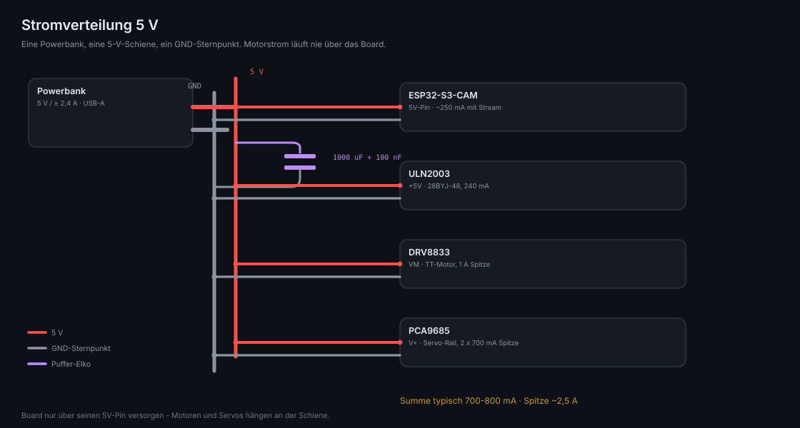
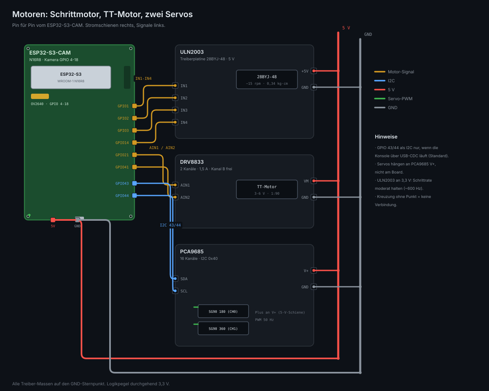
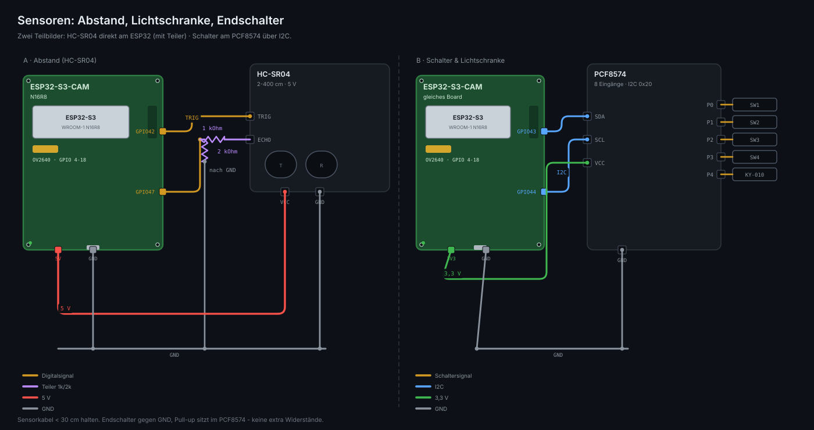
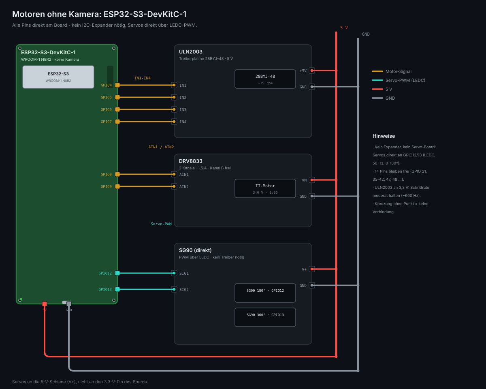
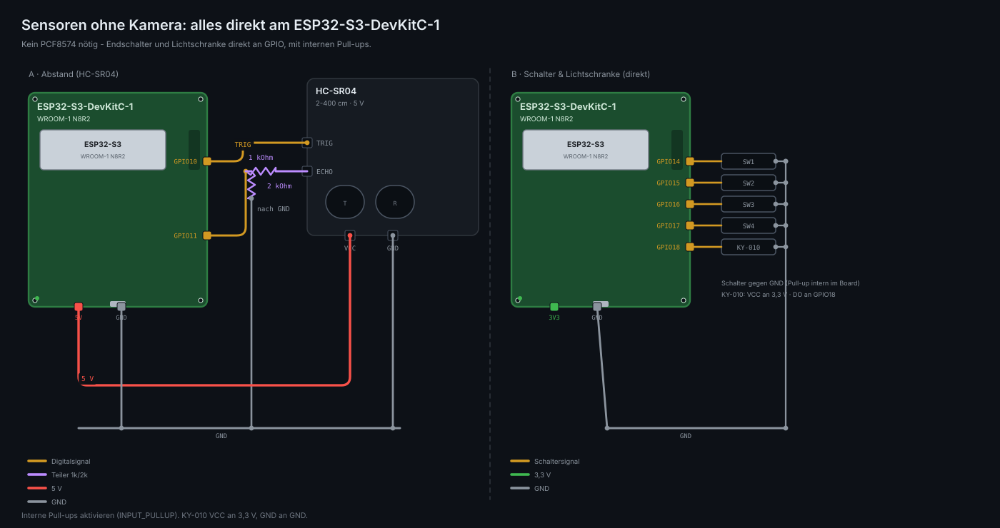

# 03 — Verkabelung & Strom

Alle Bilder sind Pin-für-Pin-Zeichnungen (SVG in `img/wiring/`, erzeugt mit `tools/wiring.py`). Das Board ist als Platinenansicht gezeichnet — jeder benutzte Pin ist **farbcodiert** (Pin-Farbe = Funktion, gleiche Farbe wie die Leitung): **rot = 5 V**, **grau = GND**, **orange = Signal**, **blau = I2C**, **grün = 3,3 V**, **türkis = Servo-PWM**, **lila = Spannungsteiler**. Kreuzung ohne Punkt heißt: keine Verbindung. Zwei Varianten: mit Kamera (Abschnitte 1–3) und ohne Kamera (Abschnitt 4).

## 1. Stromverteilung



Eine 5-V-Schiene und ein GND-Sternpunkt. Board, ULN2003, DRV8833 und die Servo-Schiene (PCA9685 V+) hängen an derselben Powerbank — aber nie über das Board.

## 2. Motoren



| Vom ESP32 | zum Treiber | Leitung |
|---|---|---|
| GPIO 1, 2, 3, 14 | ULN2003 IN1–IN4 | orange |
| GPIO 21, 41 | DRV8833 AIN1 / AIN2 | orange |
| GPIO 43, 44 | PCA9685 SDA / SCL | blau |
| 5V, GND | 5-V-/GND-Schiene | rot / grau |

Servos stecken auf **PCA9685 Kanal 0 und 1**, ihr Plus kommt von der Servo-Schiene (V+), nicht vom Board. GPIO 43/44 sind UART0-Pins — frei nur, weil die serielle Konsole über USB-CDC läuft (Standard).

## 3. Sensoren



- **HC-SR04:** VCC an 5 V, TRIG an GPIO 42. ECHO liefert 5 V → **1 kΩ in Reihe, 2 kΩ nach GND**, der Knoten geht an GPIO 47 (5 V · 2/3 = 3,3 V).
- **Endschalter 1–4** an PCF8574 P0–P3, **KY-010 Lichtschranke** an P4. Taster gegen GND, Pull-up sitzt im Modul — keine zusätzlichen Widerstände.
- PCF8574 an 3,3 V, damit der I2C-Bus im sicheren Pegelbereich bleibt.

## Pinplan

Das Board hat nach Kamera (14 GPIO), SD (3) und USB (2) noch **11 frei nutzbare Pins**:

| Funktion | Pin | Treiber / Modul |
|---|---|---|
| Schrittmotor IN1–IN4 | GPIO 1, 2, 3, 14 | ULN2003 → 28BYJ-48 |
| TT-Motor AIN1 / AIN2 | GPIO 21, 41 | DRV8833 Kanal A |
| HC-SR04 TRIG / ECHO | GPIO 42, 47 | ECHO über Spannungsteiler |
| I2C SDA / SCL | GPIO 43, 44 | PCA9685 (0x40) + PCF8574 (0x20) |
| Servo 180° / 360° | PCA9685 Kanal 0 / 1 | Servo-PWM, 50 Hz |
| Endschalter 1–4 | PCF8574 P0–P3 | Taster gegen GND |
| IR-Lichtschranke | PCF8574 P4 | KY-010 Digitalausgang |
| Reserve | GPIO 48 | Buzzer, WS2812, Relais |

**Meiden:** GPIO 0 (Boot), GPIO 45/46 (Strapping, 46 ist Input-only), GPIO 19/20 (USB), GPIO 38–40 (SD-Karte), GPIO 4–18 (Kamera).

## Fünf Regeln, die Ärger vermeiden

1. **Motorstrom niemals über das Board.** Die 5 V der Powerbank gehen auf eine eigene Schiene (Lötleiste oder Wagoklemme) und von dort auf Board, DRV8833 `VM`, ULN2003 `+5V` und PCA9685 `V+`. Nur das Board selbst wird über seinen 5V-Pin gespeist.
2. **Gemeinsame Masse ist Pflicht.** Alle GND-Punkte sternförmig zusammenführen (Powerbank-Minus als Zentrum).
3. **Niemals den 3V3-Pin des Boards** für Servos, Motoren oder Module mit eigenem Regler benutzen.
4. **HC-SR04-ECHO liefert 5 V** — der ESP32-S3 ist nicht 5-V-tolerant. Teiler: ECHO → 1 kΩ → GPIO, GPIO → 2 kΩ → GND (ergibt 3,3 V).
5. **Elko direkt an die Motorschiene**: 1000 µF/10 V plus 100 nF keramisch. Verhindert Brownout-Resets beim Anlaufen von Servos und Stepper.

## Strombedarf

| Verbraucher | typisch | Spitze |
|---|---|---|
| ESP32-S3 + WiFi + Kamerastream | 200 mA | 350 mA |
| SG90 (pro Stück, Leerlauf / stellend) | 5 mA / 200 mA | 700 mA (Blockade) |
| 28BYJ-48 | 240 mA | 260 mA |
| TT-Motor 1:90 | 150 mA | ~1 A (Anlauf/Blockade) |
| **Summe** | **~700–800 mA** | **~2,5 A** |

→ Powerbank mit **≥ 2,4 A** auf 5 V. Ein 10.000-mAh-Modell hält den Aufbau mit Stream etwa 8–10 Stunden.

**Powerbank-Falle:** Viele Modelle schalten bei < 50 mA Last ab. Trick: Stream laufen lassen oder ein Modell mit "Always-On"/Low-Current-Modus verwenden.

## I2C-Bus

| Modul | Adresse | Einstellung |
|---|---|---|
| PCA9685 (Servos) | 0x40 | Adressjumper A0–A5 alle offen |
| PCF8574 (Eingänge) | 0x20 | Alternativ 0x27 — mit I2C-Scanner prüfen |

Beide Module mit **3,3 V** versorgen, dann liegen Pull-ups und Buspegel im sicheren Bereich. Die Servos hängen trotzdem an 5 V — nur die Logikseite des PCA9685 läuft auf 3,3 V, die Servoschiene (V+) auf 5 V.

## Kabelplan (Kurzfassung zum Löten)

```
Powerbank +5V ──┬── Board 5V
                ├── DRV8833 VM
                ├── ULN2003 +5V
                └── PCA9685 V+
Powerbank GND ──┴── Board GND · DRV8833 GND · ULN2003 GND · PCA9685 GND · Elko −

Board GPIO 1,2,3,14   → ULN2003 IN1..IN4
Board GPIO 21,41      → DRV8833 AIN1, AIN2
Board GPIO 42         → HC-SR04 TRIG
Board GPIO 47         ← 1k ← HC-SR04 ECHO     (2k von GPIO 47 nach GND)
Board GPIO 43,44      → SDA/SCL (PCA9685 + PCF8574)
PCA9685 Kanal 0,1     → SG90 180°, SG90 360° (Plus an V+, GND an GND)
PCF8574 P0..P3        → Endschalter gegen GND
PCF8574 P4            → KY-010 DO (KY-010 an 3,3 V)
```

## 4. Variante ohne Kamera (ESP32-S3-DevKitC-1)

Keine Kamera heißt: die 14 Kamera-Pins (GPIO 4–18) fallen weg. Statt des CAM-Boards nimmt man ein **ESP32-S3-DevKitC-1 (WROOM-1 N8R2)** (~10–13 €), bei dem **alle 36 GPIOs auf Stiftleisten** herausgeführt sind. Damit entfallen auch die beiden Expander (PCA9685 + PCF8574) — alles hängt direkt am Board:



| Vom ESP32 | zum Ziel | Leitung |
|---|---|---|
| GPIO 4, 5, 6, 7 | ULN2003 IN1–IN4 | orange |
| GPIO 8, 9 | DRV8833 AIN1 / AIN2 | orange |
| GPIO 12, 13 | SG90 SIG (LEDC, 50 Hz) | türkis |
| 5V, GND | 5-V-/GND-Schiene | rot / grau |



| Vom ESP32 | zum Ziel | Leitung |
|---|---|---|
| GPIO 10 | HC-SR04 TRIG | orange |
| GPIO 11 | HC-SR04 ECHO (über 1k/2k-Teiler) | orange / lila |
| GPIO 14–17 | Endschalter (gegen GND, interne Pull-ups) | orange |
| GPIO 18 | KY-010 DO | orange |

**Pinplan ohne Kamera** (DevKitC-1, alles direkt):

| Funktion | Pin |
|---|---|
| Schrittmotor IN1–IN4 | GPIO 4, 5, 6, 7 |
| TT-Motor AIN1 / AIN2 | GPIO 8, 9 |
| Servo 180° / 360° | GPIO 12 / 13 (LEDC-PWM, 50 Hz) |
| HC-SR04 TRIG / ECHO | GPIO 10 / 11 (ECHO über Teiler) |
| Endschalter 1–4 | GPIO 14–17 (INPUT_PULLUP) |
| IR-Lichtschranke | GPIO 18 (VCC an 3,3 V) |
| **frei** | GPIO 21, 35–42, 47, 48 (14 Pins) |

**Unterschiede zur Kamera-Variante:** ~5 € günstiger (kein PCA9685, kein PCF8574), weniger Bauteile, kleiner. Dafür kein Kamerabild im Browser, kein I2C nötig, Servos direkt am Board. Meiden wie immer: GPIO 0 (Boot), 3/45/46 (Strapping), 19/20 (USB).

## Bilder selbst nachzeichnen

`python3 tools/wiring.py` erzeugt alle fünf SVGs neu und prüft dabei automatisch:

- jedes Kabelende sitzt auf einem Pin, einer Schiene oder einem definierten Knoten,
- kein Kabel läuft durch ein Bauteil,
- keine zwei Beschriftungen überlappen sich,
- das SVG ist wohlgeformtes XML.

`python3 tools/svg_preview.py <datei.svg>` rastert ein SVG in ein PNG — nützlich, wenn man das Ergebnis ohne Browser ansehen will.
