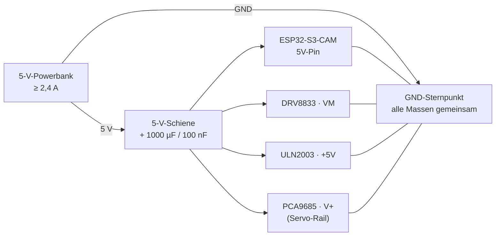
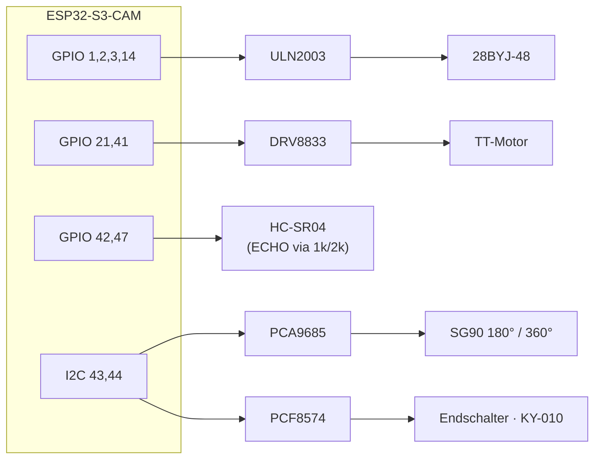

# 03 — Verkabelung & Strom

## Pinplan (Vorschlag)

Das Board hat nach Kamera (14 GPIO), SD (3) und USB (2) noch **11 frei nutzbare Pins**. Aufteilung:

| Funktion | Pin | Treiber / Modul |
|---|---|---|
| Schrittmotor IN1–IN4 | GPIO 1, 2, 3, 14 | ULN2003 → 28BYJ-48 |
| TT-Motor AIN1 / AIN2 | GPIO 21, 41 | DRV8833 Kanal A |
| HC-SR04 TRIG / ECHO | GPIO 42, 47 | ECHO über Spannungsteiler |
| I2C SDA / SCL | GPIO 43, 44 | PCA9685 (0x40) + PCF8574 (0x20) |
| Servo 180° / 360° | PCA9685 Kanal 0 / 1 | Servo-PWM, 50 Hz |
| Endschalter 1–4 | PCF8574 P0–P3 | Taster gegen GND |
| IR-Lichtschranke | PCF8574 P4 | KY-010 Digitalausgang |
| Reserve | GPIO 48 | Buzzer, WS2812, Relais |

**Meiden:** GPIO 0 (Boot), GPIO 45/46 (Strapping, 46 ist Input-only), GPIO 19/20 (USB), GPIO 38–40 (SD-Karte), GPIO 4–18 (Kamera).
**Hinweis:** GPIO 43/44 sind UART0 (TX/RX). Sie sind nur frei, wenn die serielle Konsole über USB-CDC läuft (Standard bei `ARDUINO_USB_CDC_ON_BOOT=1`). Wer den UART-Monitor braucht, nimmt stattdessen GPIO 47/48 für I2C und legt den HC-SR04 auf den Expander — dann aber mit schlechterer Echo-Auflösung.

## Stromverteilung



## Signalfluss



## Fünf Regeln, die Ärger vermeiden

1. **Motorstrom niemals über das Board.** Die 5 V der Powerbank gehen auf eine eigene Schiene (Lötleiste oder Wagoklemme) und von dort auf Board, DRV8833 `VM`, ULN2003 `+5V` und PCA9685 `V+`. Nur das Board selbst wird über seinen 5V-Pin gespeist.
2. **Gemeinsame Masse ist Pflicht.** Alle GND-Punkte sternförmig zusammenführen (Powerbank-Minus als Zentrum).
3. **Niemals den 3V3-Pin des Boards** für Servos, Motoren oder Module mit eigenem Regler benutzen.
4. **HC-SR04-ECHO liefert 5 V** — der ESP32-S3 ist nicht 5-V-tolerant. Teiler: ECHO → 1 kΩ → GPIO, GPIO → 2 kΩ → GND (ergibt 3,3 V).
5. **Elko direkt an die Motorschiene**: 1000 µF/10 V plus 100 nF keramisch. Verhindert Brownout-Resets beim Anlaufen von Servos und Stepper.

## Strombedarf

| Verbraucher | typisch | Spitze |
|---|---|---|
| ESP32-S3 + WiFi + Kamerastream | 200 mA | 350 mA |
| SG90 (pro Stück, im Leerlauf / stellend) | 5 mA / 200 mA | 700 mA (Blockade) |
| 28BYJ-48 | 240 mA | 260 mA |
| TT-Motor 1:90 | 150 mA | ~1 A (Anlauf/Blockade) |
| **Summe** | **~700–800 mA** | **~2,5 A** |

→ Powerbank mit **≥ 2,4 A** auf 5 V. Ein 10.000-mAh-Modell hält den Aufbau mit Stream etwa 8–10 Stunden.

**Powerbank-Falle:** Viele Modelle schalten bei < 50 mA Last automatisch ab. Trick: Stream laufen lassen, oder ein Modell mit "Always-On"/Low-Current-Modus (Taster doppelt drücken) verwenden.

## I2C-Bus

Beide Module hängen an denselben zwei Leitungen:

| Modul | Adresse | Einstellung |
|---|---|---|
| PCA9685 (Servos) | 0x40 | Adressjumper A0–A5 alle offen |
| PCF8574 (Eingänge) | 0x20 | Alternativ 0x27 — vor dem Verlöten mit I2C-Scanner prüfen |

Beide Module mit **3,3 V** versorgen (nicht 5 V), dann liegen die Pull-ups und damit der Buspegel im sicheren Bereich. Die Servos hängen trotzdem an 5 V — nur die Logikseite des PCA9685 läuft auf 3,3 V (VCC), die Servoschiene (V+) auf 5 V.

## Kabelplan (Kurzfassung zum Löten)

```
Powerbank +5V ──┬── Board 5V
                ├── DRV8833 VM
                ├── ULN2003 +5V
                └── PCA9685 V+
Powerbank GND ──┴── Board GND · DRV8833 GND · ULN2003 GND · PCA9685 GND · Elko −
Elko + an 5V-Schiene, 100 nF parallel

Board GPIO 1,2,3,14   → ULN2003 IN1..IN4
Board GPIO 21,41      → DRV8833 AIN1, AIN2
Board GPIO 42         → HC-SR04 TRIG
Board GPIO 47         ← 1k ← HC-SR04 ECHO     (2k von GPIO 47 nach GND)
Board GPIO 43,44      → SDA/SCL (PCA9685 + PCF8574)
PCA9685 Kanal 0,1     → SG90 180°, SG90 360° (Plus an V+, GND an GND)
PCF8574 P0..P3        → Endschalter gegen GND
PCF8574 P4            → KY-010 DO (KY-010 an 3,3 V)
```
