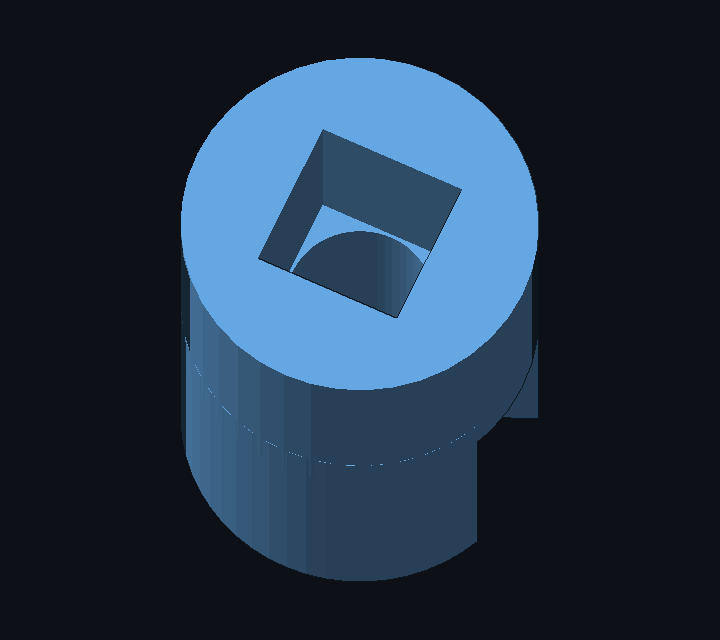
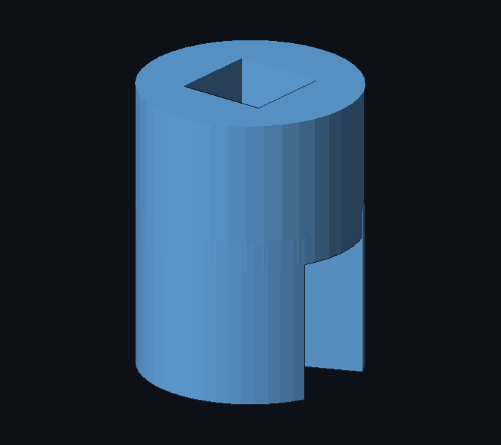

# 07 — 3D-gedruckte Adapter

Zwei Wege: **fertige Modelle** aus dem Netz (verlinkt, geprüft) und **eigene Adapter**, die hier im Repo liegen — als STL zum direkten Slicen und als parametrisches OpenSCAD zum Anpassen.

## Eigene Adapter: Klemmring → LEGO-Kreuzachse

Alle drei Teile haben denselben Aufbau (die Bilder unten sind Renderings der STL-Dateien, keine Produktfotos): unten ein **geschlitzter Klemmring** (48° Schlitz, damit PETG über die Welle federt), oben ein **Vierkant-Stecksockel** mit 4,95 mm Loch für die LEGO-Technic-Kreuzachse (4,8 mm über Kreuz). Der Sockel ist außen rund und geht direkt in den Ring über — kein Absatz, keine Stützstruktur nötig.

| Teil | Datei | Bohrung | Außenmaß | Einsatz |
|---|---|---|---|---|
| **SG90-Adapter** | `hardware/3d/adapter_sg90_lego.stl` | 4,75 mm | 11,6 × 16,5 mm | auf den 20T-Spline (Ø ~4,85 mm) statt Original-Servohorn |
| **28BYJ-48-Adapter** | `hardware/3d/adapter_byj48_lego.stl` | 4,90 mm | 11,7 × 17,5 mm | 5-mm-Welle mit Fläche → LEGO-Achse |
| **TT-Motor-Adapter** | `hardware/3d/adapter_tt_lego.stl` | 2,90 mm | 11,9 × 15,5 mm | 3-mm-D-Welle → LEGO-Achse |

**SG90-Adapter**

 

**28BYJ-48-Adapter**

 

**TT-Motor-Adapter**

 

## Drucken

- **Orientierung:** stehend, Klemmring unten auf der Platte. Keine Stützstruktur, kein Brim nötig.
- **Material:** PETG (der Ring muss federn). PLA funktioniert, bricht aber beim Aufschieben schneller.
- **0,4 mm Düse, 0,16 mm Schicht, 4 Perimeter, 30 % Infill** — die Wandstärke trägt das Drehmoment, nicht das Infill.
- **Toleranz:** Die Bohrungen sind auf 0,1 mm Übermaß gegenüber der Welle ausgelegt (Klemmung).
  - Klemmt zu starr → Bohrung im Slicer um 0,1 mm aufweiten oder Teil auf 101 % skalieren.
  - Sitzt zu locker → 98 % skalieren oder ein Stück Schrumpfschlauch unterlegen.
- **Erster Druck:** immer ein Teststück, bevor das Getriebe komplett gedruckt wird — Drucker streuen je nach Fluss und Düse um ±0,15 mm.

## Montieren

1. Original-Servohorn abziehen (Schraube in der Mitte lösen).
2. Adapter auf den Spline schieben — der Schlitz gibt nach, der Ring klemmt.
3. **Zusätzliche Sicherung:** durch das 4,95-mm-Loch passt ein M2-Schräubchen in das Gewinde im Servo-Spline. Damit ist der Adapter formschlüssig und rutscht auch bei Blockade nicht durch.
4. LEGO-Kreuzachse in den Vierkantsockel stecken (8 mm tief). Bei viel Drehmoment Achse zusätzlich mit einem Tropfen Sekundenkleber sichern.

**Grenzen:** Bei Blockade rutscht der Ring irgendwann durch — das ist Absicht (lieber der Adapter als das Servogetriebe). Für Dauerlast lieber MG90S mit Metallgetriebe und den Adapter mit Schraube sichern.

## Fertige Modelle aus dem Netz (geprüft)

| Zweck | Modell | Quelle |
|---|---|---|
| SG90 → LEGO-Kreuzachse | **SG90 mini servo to Lego axle (shaft) adapter** (nickgreaves) | [Thingiverse 7322308](https://www.thingiverse.com/thing:7322308) |
| SG90-Kupplung, kompakt | ***SG90-J LEGO motor coupling** (imaicom) | [Thingiverse 4593407](https://www.thingiverse.com/thing:4593407) |
| SG90-Halterung mit LEGO-Raster + Kupplung | **Micro servo LEGO-compatible mount** (Szaja) | [Printables 602773](https://www.printables.com/model/602773-micro-servo-lego-compatible-mount) |
| SG90-Halterung, integriert | **fully integrated Lego servo bracket** (tecdroid) | [Thingiverse 2741393](https://www.thingiverse.com/thing:2741393) |
| TT-Motor: Halter + Achsadapter | **Lego Compatible DC TT Hobby Motor Mount & Axle Adapter** (Brogan Pratt) | [Printables 1242632](https://www.printables.com/model/1242632-lego-compatible-dc-tt-hobby-motor-mount-axle-adapt) |
| 28BYJ-48 → LEGO-Technic | **28BYJ-48 stepper to Lego Technic adapter** (Agata) | [Printables 776647](https://www.printables.com/model/776647-28byj-48-stepper-to-lego-technic-adapter) |

Diese Modelle sind erprobt und decken ab, was hier noch fehlt (Halterungen, Radnaben). Die eigenen Adapter oben sind der Ersatz für den Fall, dass die Wellenmaße deiner konkreten Motoren abweichen — genau dafür sind sie parametrisch.

## Selbst nachgenerieren / anpassen

- **OpenSCAD:** `hardware/3d/adapter_lego_axle.scad` — oben `part` wählen (`"sg90"`, `"byj48"`, `"tt"`), Bohrung/Wandstärke in `params` ändern, F6 → STL exportieren.
- **Ohne OpenSCAD:** `tools/make_parts.py` erzeugt STLs, Vorschaubilder und prüft die Geometrie (geschlossene Hülle, Volumen gegen analytischen Wert). Aufruf: `python3 tools/make_parts.py`. Reines Python, keine Abhängigkeiten — `tools/mesh.py` enthält die Primitiven (Zylinder, geschlitzter Ring, Vierkantsockel), den STL-Export und einen kleinen Software-Renderer.
- Nach jeder Änderung an den Parametern prüft das Skript automatisch: `open_edges == 0` (geschlossene Hülle) und Abweichung des Volumens < 2 % — ein Tippfehler in den Maßen fällt damit sofort auf.
